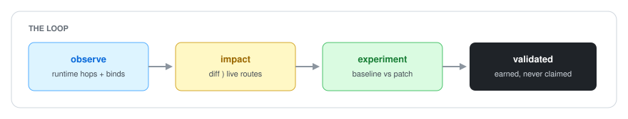
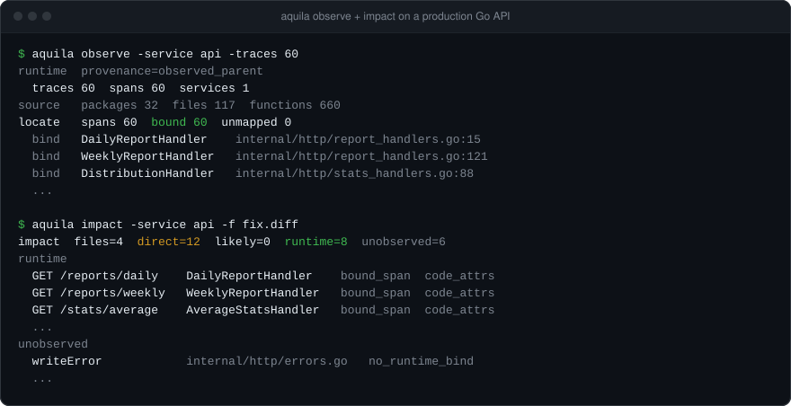
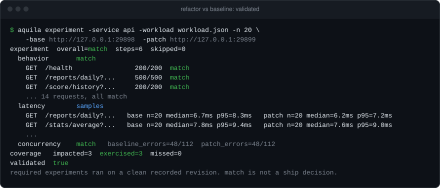
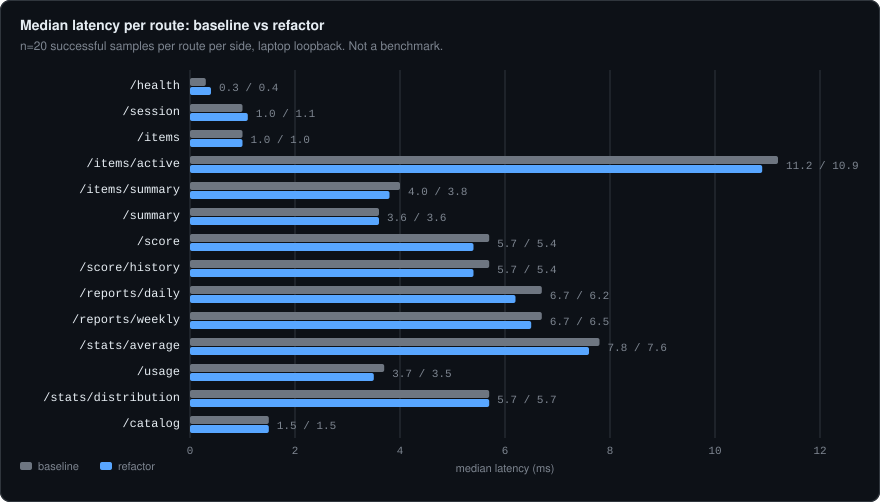
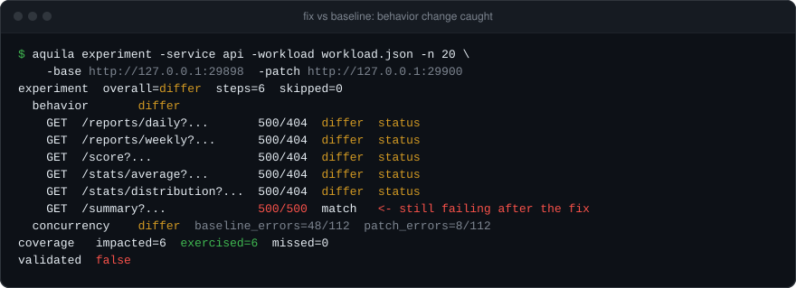
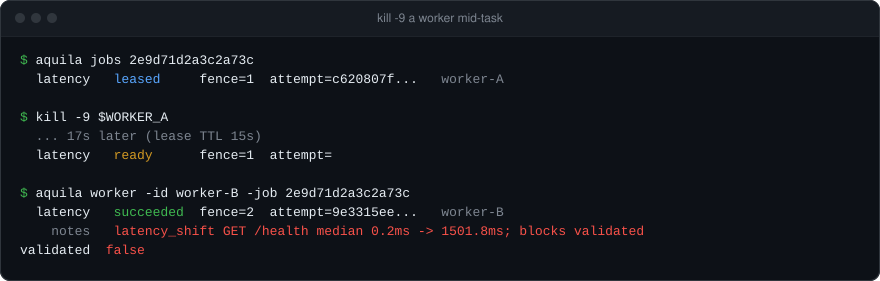

# Aquila

Pre-merge change validation for backend services, built on OpenTelemetry traces.

[](https://github.com/sumedh-aerram/Aquila/actions/workflows/ci.yml)

Aquila reads an uncommitted `git diff` and the traces a service already emits, attributes changed functions to entry routes, and replays requests against baseline and patch builds. Route attribution may be observed directly or inferred through an immediate static caller. `validated` requires built revision identities, executed comparisons, coverage of every impacted route, and no flagged latency shift. Inferred coverage does not prove that the changed callee branch ran. See [validation policy](docs/EXPERIMENTS.md).

Runs locally. Needs no production access and uses no LLM.



## Case study: a production Go API

Aquila was run against a private production Go API (32 packages, 117 files, 660 functions) that was not written with Aquila in mind. Two real commits went through the full loop: a refactor expected to change nothing, and a bug fix expected to change status codes. Route and function names are anonymized. All numbers are from recorded Aquila output.

| Measurement | Result |
| --- | --- |
| Runtime spans tied to a function and line | **60 of 60** |
| Functions the fix changed | **12**, of which **8** run on live routes |
| Refactor vs the old build | **14 of 14** requests identical, **validated** |
| Latency per route | **n=20**, medians within **0.5 ms** |
| Fix vs the old build | **5** routes went **500 to 404** as intended |
| Bug the fix missed | **1** route still returning **500** |
| Dead worker, killed mid-task | recovered in **17 s** |

### Blast radius



Every span in the window was bound to a function and line. The fix changed 12 functions; 8 of them run on observed routes. The report also lists 6 `unobserved` findings; these findings are not a disjoint count of the remaining changed functions.

Result: the set of routes to retest came from recorded traffic instead of guesswork.

### Refactor: validated



All 14 requests returned the same status on both builds, concurrency error counts matched (48 of 112 on each side), and the workload reached all 3 routes that run the refactored code.



Result: 20 samples per route showed no latency regression on any route.

### Fix: incomplete fix detected



The fix was intended to map "no data" errors from 500 to 404. Five routes changed as intended. `/summary`, also touched by the diff, still returned 500 because its error message did not match the string the fix checked for. The verdict is `differ`, not `validated`; intended behavior changes require human review.

Result: the missed route surfaced before merge.

### Failure modes

`validated` stays `false` whenever evidence is missing, and the reason is printed:

| Condition | Aquila output |
| --- | --- |
| The new build wasn't running | `incomplete`, no requests answered |
| The test traffic skipped the changed routes | `missed 7/7`, cannot validate |
| Requests had no credentials, so every route returned 401 | `auth_rejected: handler did not run` |
| The new build was 1.5 s slower | `latency_shift 0.2ms -> 1501.8ms` |

Queued jobs survive worker failure. Below, a worker is killed with `kill -9` mid-task:



The task returned to the queue when the 15 second lease expired, and a second worker completed it. The stale attempt cannot commit a result (fence 1 vs fence 2).

## Quickstart

Requires Go 1.26.10 or a compatible newer toolchain, Docker with Compose v2, Make, curl, and a C++20 compiler for `make build`. Starts Aquila and a bundled seven-service demo shop on localhost. See the [local demo runbook](docs/runbooks/local-demo.md) for ports and verification steps.

```bash
git clone https://github.com/sumedh-aerram/Aquila.git && cd Aquila
make dev && make cli && make shop-smoke

./bin/aquila observe -service gateway -traces 20
./bin/aquila impact  -service gateway -traces 20 -f internal/pair/testdata/d1.diff
make experiment-smoke              # old and new shop side by side, writes out/evidence.json
./bin/aquila report out/evidence.json
```

The smoke run takes one sample per route, so it prints `validated false` by design. Use `experiment -n 20` to meet the sample requirement; the other policy gates must also succeed. `make down` stops the stack and preserves the live demo volumes.

## Running against a service

The service must export OpenTelemetry traces to the local Collector at `127.0.0.1:4317` and set `code.function.name` and `code.file.path` on spans; those attributes bind a request to a Go function. The Collector forwards traces to Aquila's HTTP ingest endpoint. Go source mapping is implemented; other languages receive file-level analysis.

```bash
cd ~/src/billing

aquila observe -service billing        # what runs, and in which function
# make the change, leave it uncommitted
aquila impact  -service billing        # what the diff touches

# baseline build on :9001, patched build on :9002
aquila experiment -service billing \
  -base http://127.0.0.1:9001 -patch http://127.0.0.1:9002 \
  -health /health -workload workload.json -n 20 -out evidence.json
aquila report evidence.json
```

`workload.json` lists the requests to replay. Tokens are expanded from environment variables and never written to the file or the evidence:

```json
{"steps": [
  {"method": "GET", "path": "/health"},
  {"method": "GET", "path": "/user/me", "headers": {"Authorization": "Bearer ${MY_TOKEN}"}}
]}
```

Without `-workload`, Aquila derives GET/HEAD/OPTIONS requests from concrete server-span routes, preferring routes joined to the edit. Templates are omitted. Experiments using operator-provided URLs record `source=declared` on both revisions and cannot earn `validated`; Aquila does not build or attest those gateways. See [pair construction and replay](docs/components/pair-and-replay.md).

## Validation rules

`match` describes the comparison after volatile JSON fields are removed. `validated true` is a separate policy result requiring:

1. Health, behavior, latency, and concurrency results succeed, plus every additional required executable step. Missing, skipped, duplicate, and failed core steps block validation, even if omitted from the plan.
2. Both revisions have distinct immutable trees labeled `built`, distinct gateway URLs, and a clean baseline. An uncommitted patch can validate after snapshotting and building; URL-only declarations cannot.
3. At least 20 recorded latency samples for every workload row on each side.
4. At least one changed function is bound, no changed path remains unanalyzed, and every impacted route receives an answered request on both builds without an auth refusal on both sides. Caller-inferred coverage is accepted and disclosed.
5. No patch median is more than 2x baseline and at least 5 ms slower.

The server re-derives policy from submitted evidence and rejects inconsistent claims. Uploaded results and `built` labels remain client-attested; digest integrity does not prove execution. The policy and regression tests are in `internal/validate/decide.go` and `internal/validate/decide_test.go` (`TestDecideDirtyPatchValidates`, `TestDecideAllRoutesRequired`, `TestDecideCoverageBasis`).

## Commands

| Local | |
| --- | --- |
| `observe` | What ran, and which function handled each request |
| `impact` | Functions and live routes the diff touches |
| `experiment` | Old build vs new build: behavior, latency, errors, coverage |
| `report` | Readable Markdown from an evidence file |
| `ask "..."` | Facts from traces and code that match a question |

| Control plane | |
| --- | --- |
| `runs` | History of every experiment, stored in Postgres |
| `job`, `jobs`, `worker` | Queue experiments and run them on workers, with crash recovery |
| `plan`, `run` | Preview the experiment plan, or investigate, plan, and run in one step |
| `status`, `attaches` | Is Aquila up, and which services are sending traces |

<details>
<summary>Status</summary>

**Implemented and tested:** observe, impact, plan, experiment, and report on an external Go codebase. Coverage and latency gates on `validated`. Queued jobs across multiple workers with leases, heartbeats, and fencing against stale workers. Live crash recovery. Per-service lease quotas. Result caching, a container sandbox, and a native process supervisor. Prometheus and Grafana for Aquila itself.

**Not built yet:** AI agents, automatic patches for any app (`patch` only knows the demo shop), function mapping for Python, GitHub PR integration, a web dashboard, a live cloud deployment.

</details>

<details>
<summary>Operator notes</summary>

- When traces contain more than one service, pass `-service` so another app cannot crowd out the target.
- `:8080` is Aquila's API; run the target service on another port.
- From the host, export traces to `127.0.0.1:4317`. `otel-collector:4317` only resolves inside Docker.
- Queued jobs refuse workloads with headers, so credentials never end up in the database. Run authenticated experiments with `aquila experiment` locally.
- Set `AQUILA_API_TOKEN` to require a token on the API and the worker port. Local Compose leaves it empty and only listens on `127.0.0.1`.
- `AQUILA_LEASED_TASKS_PER_SERVICE` limits how many tasks one service can run at once.
- Telemetry and evidence omit request and response bodies. Queued jobs persist operator-supplied request bodies. Evidence may retain query values; keep secrets out of request paths. See [docs/SECURITY.md](docs/SECURITY.md).

| Service | URL |
| --- | --- |
| Aquila API | http://127.0.0.1:8080/healthz |
| Demo shop | http://127.0.0.1:18080/healthz |
| Grafana | http://127.0.0.1:13000 (`admin` / `aquila`, local only) |
| Traces (OTLP) | `:4317` gRPC, `:4318` HTTP |

</details>

## Develop

```bash
make build && make test && make lint
```

`make test` needs Docker for the sandbox test and a migrated, isolated PostgreSQL database for complete integration coverage. See [CONTRIBUTING.md](CONTRIBUTING.md) for the non-Docker subset and full CI gates.

## Documentation

Start with the [documentation index](docs/README.md), then [architecture](docs/ARCHITECTURE.md), [experiments](docs/EXPERIMENTS.md), and the [CI runbook](docs/runbooks/ci.md). The case study above is historical recorded output, not a reproducible benchmark publication; see [benchmark policy](docs/BENCHMARKS.md).

## License

Source in this repository is for the Aquila project. Licensing will be declared before a public release.
