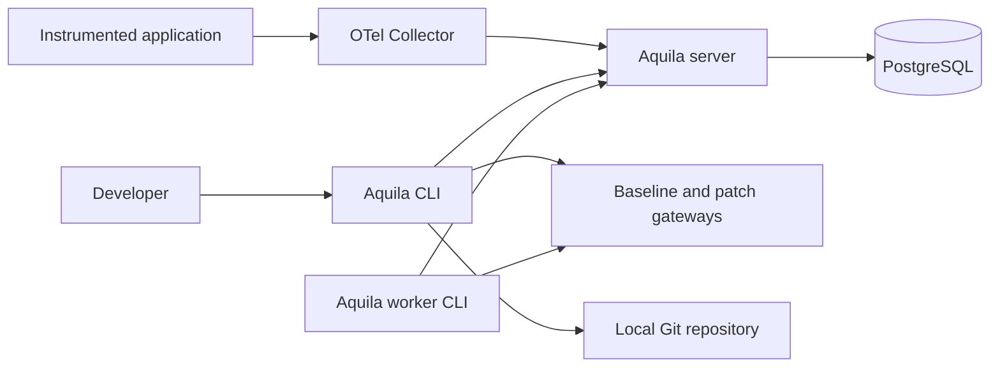
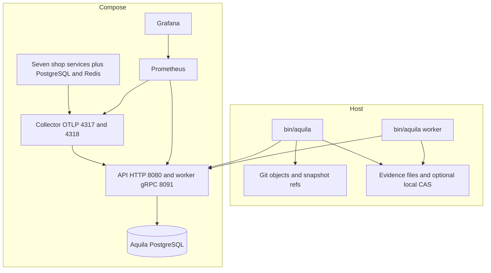
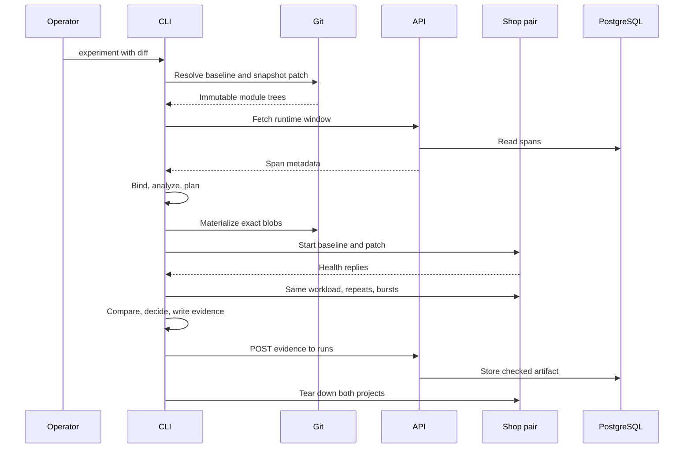
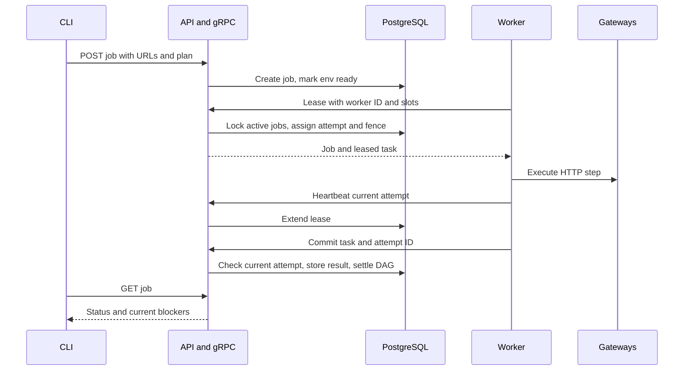

# Architecture

Aquila is a modular Go control plane plus a CLI. PostgreSQL holds span metadata, experiment runs, and whole job DAG payloads. Source and runtime graphs are derived views rather than persisted graph tables. `cmd/server/main.go` wires the stores into `internal/api/server.go:NewServer`.

## System context and containers

Published ports bind to loopback in `deploy/compose/docker-compose.yaml` and `deploy/compose/docker-compose.shop.yaml`. Pair creation starts additional shop-only Compose projects; their collectors export debug output rather than feeding experiment traces back into the live model (`internal/pair/otel.yaml`).

## Product loop

| Stage | Implemented path | Evidence and limits |
| --- | --- | --- |
| Observe | `internal/ingest/otlp.go:NormalizeReport`, `internal/ingest/window.go:SelectWindow` | Allowlisted spans, recent non-probe trace window; `TestNormalizeKeepsRouteAndDropsBody` |
| Graph and bind | `internal/graph/graph.go:Build`, `internal/locate/bind.go:Bind` | Parent links and explicit code attributes; `TestEntryForSpanRequiresCompleteAncestry` |
| Impact | `internal/impact/analyze.go:Analyze` | Function extents, depth-one callers, entry routes; `TestAnalyzeCallerDepth` |
| Plan | `internal/plan/plan.go:FromImpact` | Env, behavior, latency, conditional concurrency/fault; `TestFromImpactIncludesConcurrencyAndFaultWhenRuntime` |
| Pair | `internal/gitrev/snapshot.go:SnapshotWorktreeAt`, `internal/pair/prepare.go:Prepare` | Exact Git blobs, independent shop projects; `TestSnapshotDoesNotTouchIndex`, `TestMaterializeExact` |
| Replay/compare | `internal/plan/run.go:Execute`, `internal/replay/compare.go:Compare` | Status/body comparison, latency, error counts; `TestExecuteJSONDifference` |
| Decide | `internal/validate/decide.go:Decide` | Ordered blockers; caller inference disclosed; `TestDecideReportsAllBlockers`, `TestDecideCoverageBasis` |
| Evidence | `internal/evidence/artifact.go:Build`, `internal/runs/postgres.go:Insert` | v3 JSON, digests, current decision on read; `TestBuildV3DigestStable`, `TestCreateRunIdempotent` |

`ask` searches recorded facts and `run` composes investigation, candidate generation, and execution. Neither calls an LLM. Rewrites are limited to shop D1–D6 (`internal/investigate/search.go`, `internal/rewrite/shop.go`, `internal/cli/workflow.go:RunWorkflow`).

## Processes and dependency direction

| Binary | Role |
| --- | --- |
| `bin/aquila` | Command dispatch from `cmd/aquila/main.go`; local source/Git work, replay, evidence rendering, HTTP client, and worker subcommand |
| `bin/aquila-server` | `cmd/server/main.go`; HTTP API, worker gRPC listener, periodic lease reaper, database stores |
| `bin/sourceindex` | `cmd/sourceindex/main.go`; typed Go source snapshot for images without a Go toolchain |
| `bin/aquila-exec` | `executor/src/main.cpp`; native subprocess supervisor invoked through `internal/nexec/nexec.go:Run`, separate from replay |

The server composition root depends on API, config, source, and store packages. API handlers depend on graph, impact, evidence, and job APIs. CLI commands orchestrate those APIs and local experiments. The graph pipeline depends on normalized ingest data and typed source nodes; it has no CLI dependency. Validation depends on structured plan/replay/revision/impact inputs. Evidence and jobs invoke validation. Workers depend on jobs, plan, and optional action cache; cache uses local CAS. These directions are visible in the imports of the entry files above, `internal/cli/plan.go`, `internal/impact/analyze.go`, `internal/evidence/artifact.go`, and `internal/worker/execute.go`.

## Durable and derived data

| Store | Contents and implementation |
| --- | --- |
| `aquila` schema | Namespace created by `migrations/000001_init.up.sql` |
| `aquila.spans` | `(trace_id, span_id)` primary key and normalized metadata; service/time indexes (`migrations/000002_spans.up.sql`) |
| `aquila.runs` | Evidence JSONB, revision summary, digests, verdict; `migrations/000003_runs.up.sql`, amended by `migrations/000005_validation.up.sql` |
| `aquila.jobs` | Status/URL columns and JSONB containing plan, workload, tasks, current attempt, fence, and results; `migrations/000004_jobs.up.sql`, amended by migrations 005 and 006 |
| Git | Module trees, synthetic snapshot commits, `refs/aquila/snapshots/<tree>` pins (`internal/gitrev/snapshot.go:Pin`); no snapshot garbage collection policy |
| Files | Pair manifest/materialized blobs and local evidence JSON/Markdown (`internal/pair/prepare.go`, `internal/cli/report.go`) |
| Optional local CAS | SHA-256 objects and action-digest index under `AQUILA_CAS_DIR` (`internal/cas/cas.go`, `internal/action/cache.go`) |
| Derived graphs | Runtime snapshots in memory per window; typed Go graph loaded locally or from JSON (`internal/source/snapshot.go`, `internal/graph/graph.go`) |

There are no separate task/attempt, artifact, SLO, or graph-node SQL tables. MinIO/GCS artifact adapters are not implemented. The shop has its own database and migrations under `examples/shop/migrations/`.

## Local experiment sequence

This is `internal/cli/plan.go:RunExperiment`. A URL-only run bypasses pair build and records declared revisions. Store failure prints `unrecorded`; it does not create a durable run. Cleanup failure is printed separately. Regression tests include `TestRunExperimentAnalyzesBuiltSnapshot` and `TestRevisionRefusalVisible` in `internal/cli/cli_test.go`.

## Worker job sequence

The gRPC protocol is manually registered and JSON-encoded, not generated protobuf messages (`internal/worker/rpc.go:Register`). Jobs never materialize trees and cannot earn built validation (`internal/jobs/enqueue.go:buildJob`, `TestJobValidationRequiresBuiltRevisions`).

## Implemented versus not yet

Implemented paths include Go/OTLP mapping, interpreted impact, local shop pair comparisons, evidence/history, queued HTTP tasks, lease recovery, per-service quotas, local result caching, standalone execution helpers, and platform metrics. Read [invariants](INVARIANTS.md) before treating these as guarantees.

Not yet implemented: arbitrary application build environments, worker tree builds, server-verified execution attestations, full attempt history, CPU/memory-aware scheduling, tenant isolation/fairness, Python function analysis, SLO joins, general patch generation, PR integration, or a web operational dashboard. Terraform defines Cloud Run/Cloud SQL resources (`deploy/terraform/main.tf`); configuration is not evidence of an applied deployment.
